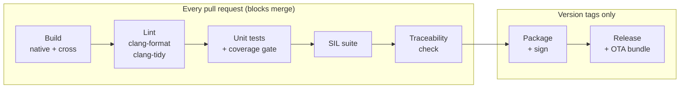
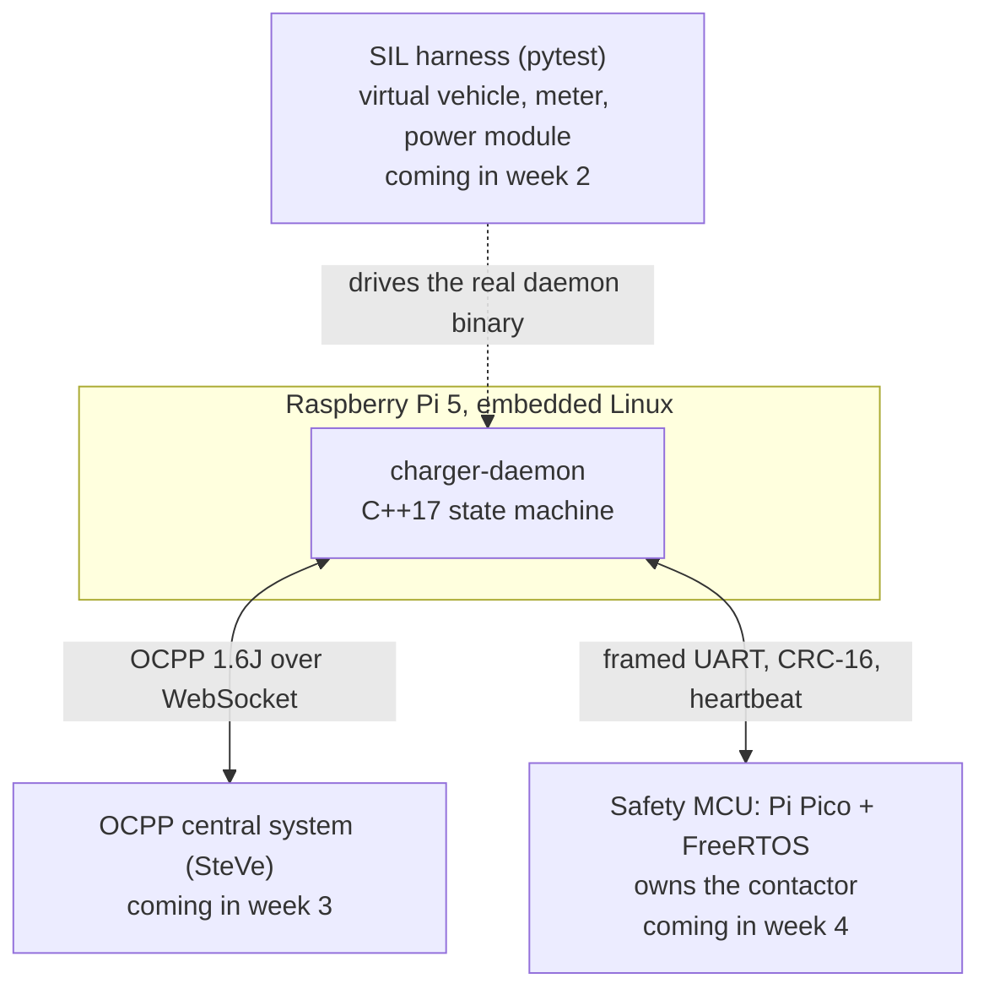

# ChargingSystemForVehicles

[]
(https://github.com/rmdesmond/ChargingSystemForVehicles/actions/workflows/ci.yml)

A small EV charge controller built end to end: a C++17 daemon for embedded
Linux on a Raspberry Pi 5 that runs the charging state machine, plus the
pipeline that builds, tests, signs and ships it. The daemon is deliberately
simple. The point of the project is the engineering around it: a CI/CD pipeline
that blocks bad changes, tests at unit, software-in-the-loop and hardware
level, signed over-the-air updates with rollback, and a documented safety
concept.

## Pipeline

Target: under 10 minutes per pull request. Status today: build, lint and unit
tests with coverage run on every pull request and block the merge; the other
stages arrive one at a time. Measurements are in
[docs/ci-metrics.md](docs/ci-metrics.md).

Every change reaches `main` through a pull request that must pass the first
five stages. The last two run only when a version tag is pushed.



Target: under 10 minutes per pull request. Status today: the build stage works
locally; the rest arrive stage by stage.

## Build in three commands

On Ubuntu 24.04 with `cmake`, `ninja-build`, `g++` and `ccache` installed:

```sh
git clone git@github.com:<you>/<repo>.git && cd <repo>
cmake --preset native
cmake --build --preset native && ctest --preset native
```

Cross-builds use the same three steps with `cross-x86_64` (from an aarch64
host) or `cross-aarch64` (from an x86-64 host); the unit tests then run under
QEMU user-mode emulation. `scripts/verify.sh` does all of it from a clean
clone.

## Development

Enable the pre-commit format check once per clone:

```sh
git config core.hooksPath .githooks
```

| Task | Command |
|------------------------------|------------------------------------------------|
| Format the code | `scripts/format.sh` |
| Static analysis | `cmake --build --preset native --target tidy` |
| Tests with coverage report | `scripts/ci.sh test` |
| All CI steps, on this host | `scripts/ci.sh all` |
| All CI steps, in CI's image | `scripts/build-in-docker.sh scripts/ci.sh all` |

CI runs `scripts/ci.sh` inside the image built from `docker/Dockerfile`, so a
failure on a pull request can be reproduced locally with the last command.

## Architecture



## Testing

Unit tests today; SIL and HIL to follow. See [docs/testing.md](docs/testing.md).

## Releases and OTA

Signed releases and A/B updates with rollback arrive in week 2.

## Safety concept

Hazards, safe states and the Linux/MCU split. See
[docs/safety-notes.md](docs/safety-notes.md).

## Decision records

Each significant decision is recorded under `docs/adr/`.