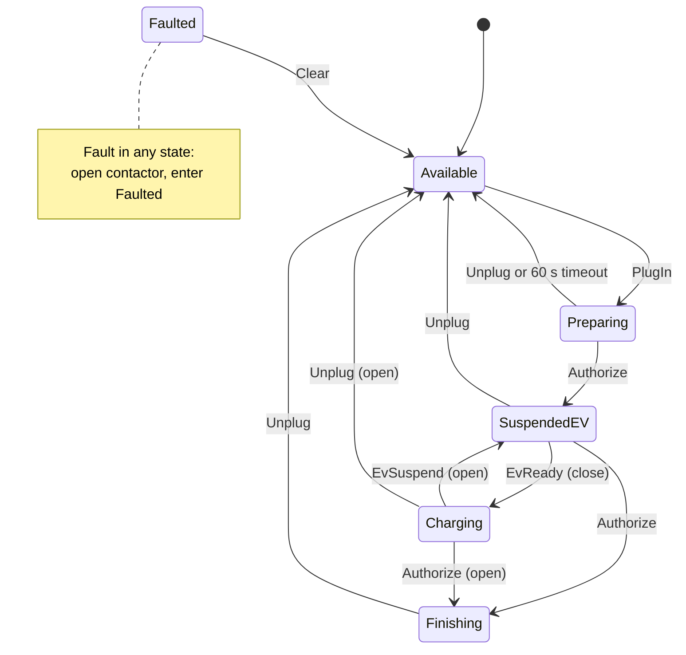

# Design: charging state machine

The daemon's core is one state machine per connector. It is written as a
transition table so that this document, the code and the tests can be compared
row by row.

## States

The names are the OCPP 1.6 connector statuses, so week 3's status reporting is
a direct mapping.

| State      | Meaning                                                    | Contactor |
-------------|------------------------------------------------------------|-----------|
| Available  | Idle, nothing connected                                    | open      |
| Preparing | Cable connected, waiting for the user to authorize          | open      |
| SuspendedEV | Authorized; the charger is ready but the vehicle is not   | open      |
| Charging | Energy is flowing                                            | closed    |
| Finishing | Session stopped by the user; waiting for the cable to go    | open      |
| Faulted | A fault was reported; nothing happens until it is cleared     | open      |

## Events

| Event     | Meaning                                                        |
|-----------|----------------------------------------------------------------|
| PlugIn    | The connector was mated with the vehicle                       |
| Authorize | A valid credential was presented: once to start, again to stop |
| EvReady   | The vehicle signalled it is ready to accept energy             |
| EvSuspend | The vehicle paused the session (battery full, preconditioning) |
| Unplug    | The connector was removed                                      |
| Fault     | Any monitor reported a fault                                   |
| Clear     | An operator cleared the fault                                  |

## Transition table

| #  | From         | Event      | To          | Contactor |
|----|--------------|------------|-------------|-----------|
| 1  | Available    | Plugin     | Preparing   | -         |
| 2  | Preparing    | Authorize  | SuspendedEV | -         |  // Suspended because EV must also be ready
| 3  | Preparing    | Unplug     | Available   | -         |
| 4  | SuspendedEV  | EvReady    | Charging    | close     |  // Ok. EV is ready. Charge!
| 5  | SuspendedEV  | Authorize  | Finishing   | -         |
| 6  | SuspendedEV  | Unplug     | Available   | -         |
| 7  | Charging     | EvSuspend  | SuspendedEV | open      |
| 8  | Charging     | Authorize  | Finishing   | open      |
| 9  | Charging     | Unplug     | Available   | open      |
| 10 | Finishing    | Unplug     | Available   | -         |
| 11 | Available    | Fault      | Faulted     | open      |
| 12 | Preparing    | Fault      | Faulted     | open      |
| 13 | Charging     | Fault      | Faulted     | open      |
| 14 | SuspendedEV  | Fault      | Faulted     | open      |
| 15 | Finishing    | Fault      | Faulted     | open      |
| 16 | Faulted      | Fault      | Faulted     | open      |
| 17 | Faulted      | Clear      | Available   | -         |

Six states and seven events give 42 pairs. The 17 above cause a transition; the
other 25 are ignored: the state does not change and the contactor is not touched.

## Requirements

- **REQ-001** The controller shall take exactly the transitions in the table and ignore every other event.
- **REQ-002** The contactor shall be commanded closed only on entering Charging.
- **REQ-003** The contactor shall be commanded open on every transition out of Charging.
- **REQ-004** A Fault event in any state shall command the contactor open and enter Faulted.
- **REQ-005** While Faulted, the contactor shall not be commanded closed; only Clear leaves Faulted.
- **REQ-006** If Preparing lasts 60 s without authorization, the controller shall return to Available.
- **REQ-007** The contactor shall not be commanded closed unless the vehicle interface reports plugged in and ready; otherwise the controller shall open the contactor and enter Faulted.

## Diagram

